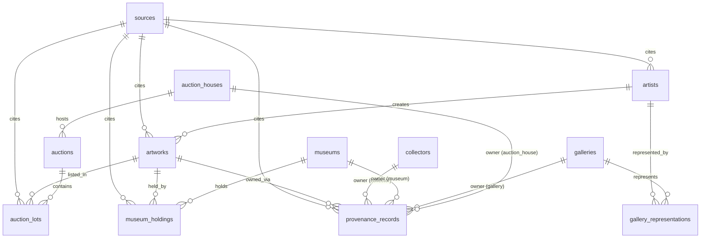

# DB 스키마 — 작가·작품·경매·미술관·갤러리·컬렉터

로드맵 2단계 산출물. 마이그레이션 원본: [`db/migrations/0001_init_schema.sql`](../db/migrations/0001_init_schema.sql)

## 설계 원칙

- **모든 레코드는 `source_id`로 출처를 인용한다.** LLM 위키가 "근거를 인용해 답하는" 것을 DB 레벨에서 뒷받침하기 위해, 크롤러가 채운 값은 반드시 `sources` 테이블(원본 URL, 수집 시각, 원본 파일 경로)을 가리킨다.
- **프로버넌스(소장 이력)가 관계망의 핵심이다.** `provenance_records`가 작품 하나를 축으로 컬렉터·미술관·갤러리·경매사를 시간순으로 잇는다 — 이게 이 프로젝트를 "DB + 검색 UI"에서 벗어나게 하는 지점.
- **비정형 값은 text로 허용.** `artworks.year_created`처럼 "c.1900", "20세기 초" 같은 실제 미술사 자료의 애매한 표기를 살리기 위해 int로 강제하지 않았다.
- **매칭 실패를 허용한다.** `auction_lots.artwork_id`, `provenance_records.owner_*_id`는 nullable — 크롤링 시점에 다른 엔티티와 매칭이 안 될 수 있음을 정상 상태로 취급한다.

## ERD

## 테이블 요약

| 테이블 | 역할 |
|---|---|
| `sources` | 모든 데이터의 출처(URL·수집시각·원본 경로) — 인용 근거 |
| `artists` | 작가 |
| `artworks` | 작품 (작가 미상 허용) |
| `auction_houses` / `auctions` / `auction_lots` | 경매사 → 개별 경매 → 출품작(낙찰가·추정가) |
| `museums` / `museum_holdings` | 미술관 → 소장품(취득경위·기증자) |
| `galleries` / `gallery_representations` | 갤러리 → 대표 작가 관계(기간 포함) |
| `collectors` | 컬렉터(개인/기관) |
| `provenance_records` | **작품 소유 이력 체인** — collector/museum/gallery/auction_house를 owner_type으로 분기, 시간순 소유 기록 |

## 다음 단계

로드맵 3단계(크롤러 개발 + 초기 적재)로 넘어가기 전 확인할 것:

- [ ] `owner_type` CHECK 제약이 실제 크롤링 데이터의 소유자 유형을 다 커버하는지 1차 대상 사이트 확정 후 재검토
- [ ] Supabase 프로젝트에 이 마이그레이션 적용 (`db/migrations/0001_init_schema.sql`)
- [ ] RLS(Row Level Security) 정책은 이 단계에서는 보류 — 내부 파이프라인 전용이므로 서비스 프론트엔드가 붙는 시점에 설계
</content>
